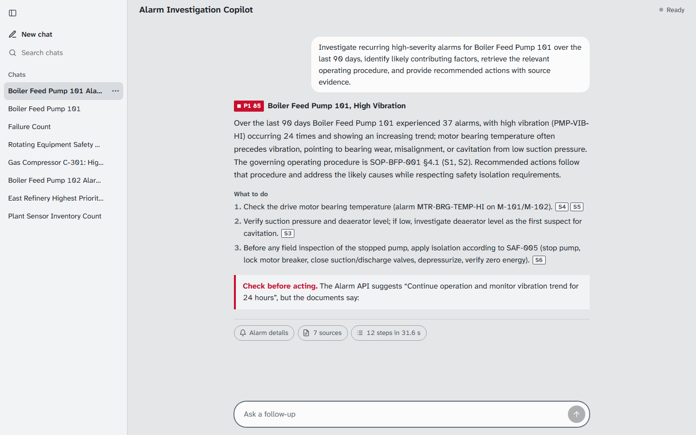
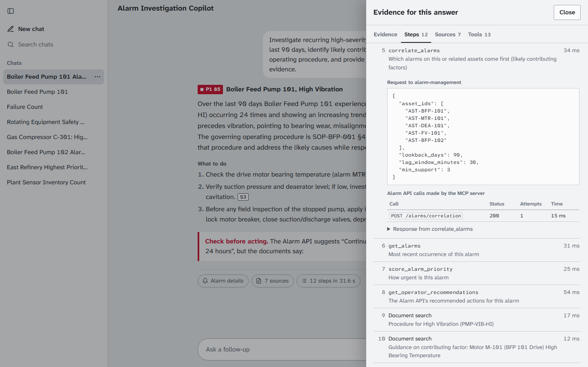
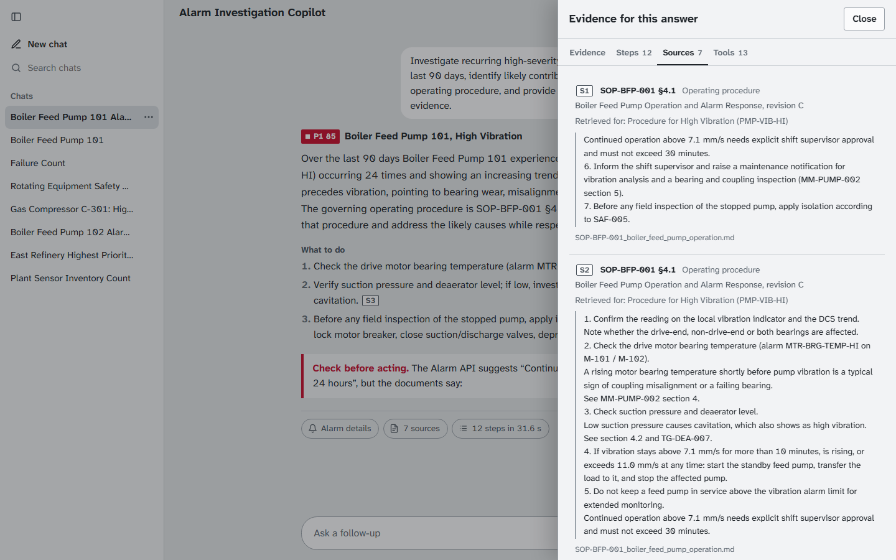
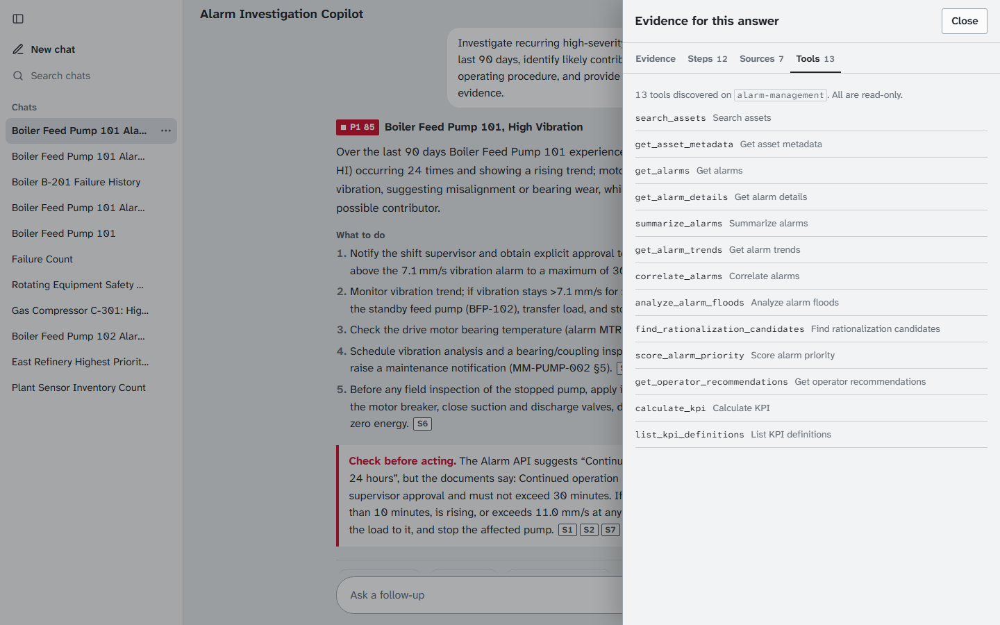
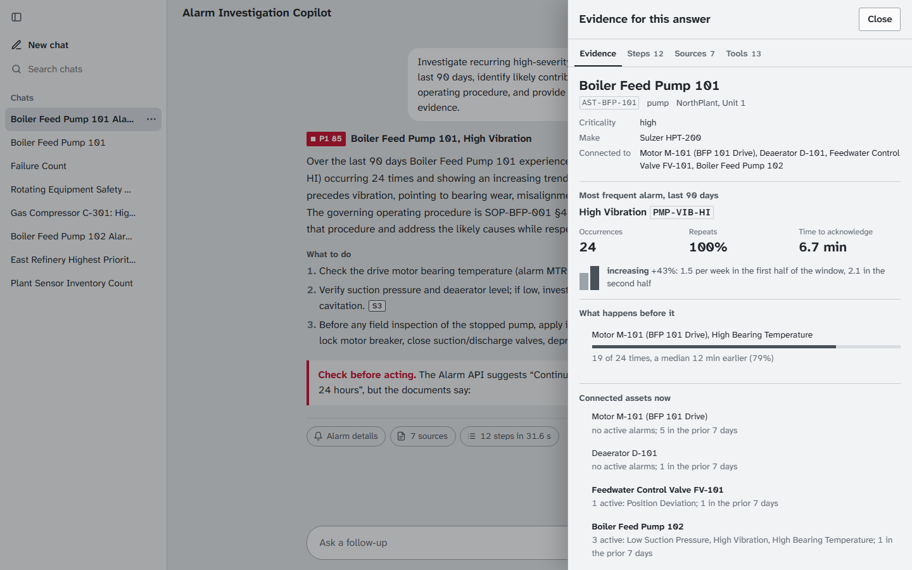
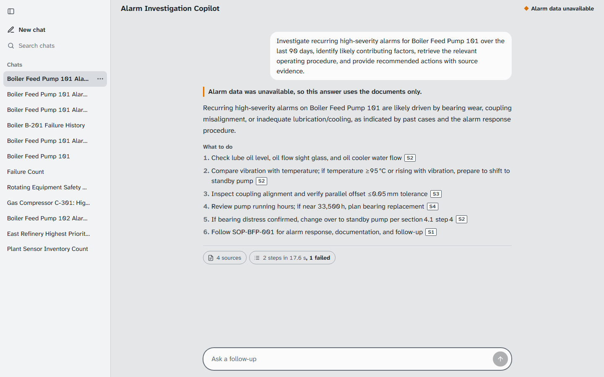
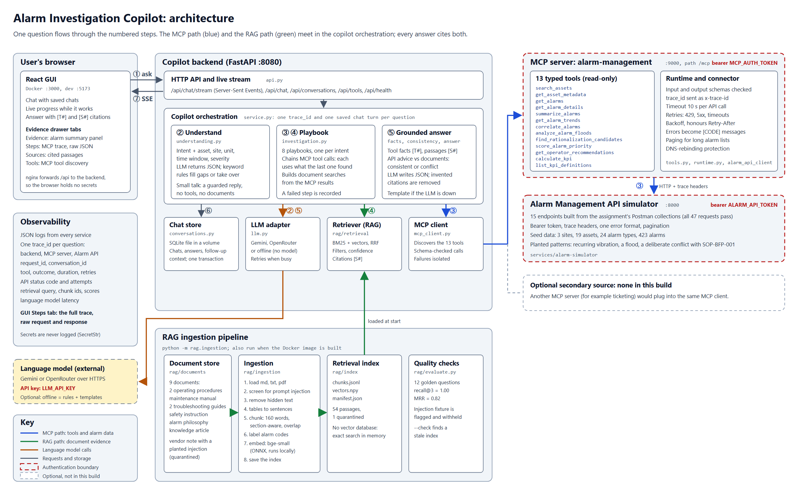

# Alarm Investigation and Procedure Guidance Copilot

[](https://github.com/shubshub-bol/Alarm-Investigator-copilot-/actions/workflows/ci.yml)

> Senior Software Engineer – Copilot Integration assignment.
> **Selected use case:** Alarm Investigation and Procedure Guidance Copilot.

An assistant that investigates industrial plant alarms. It pulls live alarm data through a **candidate-built MCP
server** and procedure guidance through **document RAG**, then combines both into one grounded answer in which
every statement cites its evidence, with the full tool trace one click away.



**Demo video (up to 10 minutes):** _link added after recording_

| Start here | |
|---|---|
| Run it | [Quick start](#quick-start) - one command with Docker |
| See how it works | [Architecture](docs/architecture.md) and [diagram](docs/architecture-diagram.png) |
| MCP | [MCP server](#mcp-server) and the [tool catalog](docs/mcp-tool-catalog.md) |
| RAG | [Document RAG](#document-rag) and the [RAG design](docs/rag-design.md) |
| Quality | [Tests](#build-run-and-test) and [coverage](docs/coverage.md) |

## Main capabilities

- **Natural-language investigation.** Ask about an asset, a site or an alarm. With a language model, an agent
  answers by choosing one step at a time (at most 6): a proven investigation (6 recipes), a read-only MCP tool or
  a document search. The direct answer comes first: a number for "how many", a side-by-side for "compare", the
  first step for "what should I do". Without a model, keyword rules pick one of 8 playbooks and the details
  (asset, site, unit, time window, severity).
- **MCP tool chaining.** The copilot discovers the MCP server's 13 tools and chains them, each call using the
  last one's result: asset search, metadata and related assets, alarm summary and trend, correlation, latest
  alarm, priority score, the Alarm API's recommendations. The agent can also combine the small tools for
  questions no playbook covers.
- **Document RAG in the same workflow.** Searches built from the MCP results find the right procedure, the
  troubleshooting guidance for the contributing factor, and the safety rules, using hybrid keyword and vector
  search.
- **Grounded, checked answers.** Every statement cites a tool fact `[T#]` or a document passage `[S#]`; invented
  citations are removed. Each Alarm API recommendation is checked against the procedures, and conflicts are
  shown as "Check before acting".
- **Traceability.** One trace id per question across the backend, MCP server and Alarm API; the GUI shows every
  tool call with its raw request and response, every document search with scores, and the discovered tools.
- **Graceful degradation.** Without a language model it uses rules and templates; without the MCP server it
  answers from documents and says so; failed steps are listed as gaps.
- **A usable GUI.** Chat with saved chats, live progress, evidence drawer, light and dark themes, responsive.

## Quick start

With Docker (Docker Desktop or Docker Engine with Compose v2):

```bash
git clone https://github.com/shubshub-bol/Alarm-Investigator-copilot-.git
cd Alarm-Investigator-copilot-
docker compose up --build
```

Open **http://localhost:3000** and click the first example question. The first build downloads the embedding
model and builds the document index inside the image (a few minutes); later starts take seconds.

No `.env` is needed: by default the language model is off (rules and template answers) and demo tokens are used.
To use a language model, copy `.env.example` to `.env` and set `LLM_PROVIDER`, `LLM_MODEL` and `LLM_API_KEY`
(see [Configuration](#configuration)), then run `docker compose up --build` again.

Check the running stack end to end (all services healthy, then the acceptance question with its tool chain,
citations and conflict check):

```bash
python scripts/smoke_stack.py
```

### Without Docker

Prerequisites: Python 3.12, [uv](https://docs.astral.sh/uv/), Node.js 24.

```bash
uv sync
npm --prefix apps/frontend ci
cp .env.example .env              # Windows PowerShell: Copy-Item .env.example .env
uv run python -m rag.ingestion    # builds rag/index (downloads the model once)
```

Then start the four programs, each in its own terminal, from the repository root:

```bash
uv run python -m alarm_simulator        # Alarm Management API, http://localhost:8000
uv run python -m alarm_mcp              # MCP server, http://localhost:9000/mcp
uv run python -m copilot                # copilot backend, http://localhost:8080
npm --prefix apps/frontend run dev      # GUI, http://localhost:5173
```

Then run `python scripts/smoke_stack.py --base-url http://localhost:5173` to check it.

## Configuration

All settings come from environment variables or `.env` ([`.env.example`](.env.example) lists them with comments).
Secrets live only in `.env`, which git ignores.

| Variable | Default | Used by | Meaning |
|---|---|---|---|
| `SIM_API_TOKEN` | `demo-token` | simulator | Token the Alarm API accepts |
| `ALARM_API_BASE_URL` | `http://localhost:8000` | MCP server | Where the Alarm API is |
| `ALARM_API_TOKEN` | required | MCP server | Token for the Alarm API (must equal `SIM_API_TOKEN`) |
| `ALARM_API_TIMEOUT_SECONDS`, `ALARM_API_MAX_RETRIES` | 10, 3 | MCP server | Per-call timeout and retries |
| `MCP_HOST`, `MCP_PORT` | `127.0.0.1`, 9000 | MCP server | Where it listens |
| `MCP_AUTH_TOKEN` | required | MCP server, backend | Bearer token for `/mcp` |
| `MCP_SERVER_URL` | `http://localhost:9000/mcp` | backend | Where the MCP server is |
| `LLM_PROVIDER` | `offline` | backend | `gemini`, `openrouter` or `offline` |
| `LLM_MODEL`, `LLM_API_KEY` | | backend | Model name and key, e.g. `gemini-flash-latest` or `vendor/model:free` |
| `LLM_THINKING_LEVEL` | `LOW` | backend | How long a reasoning model thinks |
| `COPILOT_DB_PATH` | `.data/copilot.sqlite3` | backend | Saved chats (SQLite) |
| `DOCUMENT_PATH` | `./rag/documents` | ingestion | The document corpus |
| `LOG_LEVEL` | `INFO` | all | Log level |

In Docker, `docker-compose.yml` sets the addresses between containers, uses `ALARM_API_TOKEN` on both sides of
the Alarm API, and reads tokens and `LLM_*` values from `.env` when it exists.

The guidelines' sample `.env` also lists `VECTOR_STORE_URL` and `TICKETING_API_URL`. Neither is needed here: the
document index is a set of local files (no vector database, see [RAG design](docs/rag-design.md)), and this use
case has no ticketing system.

## Build, run and test

| Task | make | Plain command |
|---|---|---|
| Start everything (Docker) | `make up` | `docker compose up --build` |
| Stop | `make down` | `docker compose down` |
| Smoke test a running stack | `make smoke` | `uv run python scripts/smoke_stack.py` |
| Install dependencies | `make install` | `uv sync --locked` and `npm --prefix apps/frontend ci` |
| Build the document index | `make ingest` | `uv run python -m rag.ingestion` |
| Python tests (572) | `make test-python` | `uv run pytest` |
| GUI tests (82) | `make test-gui` | `npm --prefix apps/frontend run test` |
| Coverage report | `make coverage` | see [docs/coverage.md](docs/coverage.md) |
| Formatting, lint, types | `make lint` | `uv run ruff format --check .`, `uv run ruff check .`, `uv run mypy`, `npm --prefix apps/frontend run typecheck` |
| Retrieval quality | | `uv run python -m rag.evaluate` |
| Answer quality (34 questions, 4 more with a model) | | `uv run python -m copilot.evaluate` (add `--llm --limit 10 --report FILE` to use the model) |
| Dependency audit | `make audit` | see the `Makefile` |

The Python tests include unit, MCP server, MCP client, RAG, orchestration, API, error-path and end-to-end tests;
the end-to-end test starts three real servers over HTTP and runs the acceptance question. Coverage is 95%.

GitHub Actions ([ci.yml](.github/workflows/ci.yml)) runs on every push and pull request: formatting, lint
(including security rules), mypy, all Python tests with coverage, the GUI's type check, tests and production
build, a dependency audit, and a Docker job that builds and starts all four services and runs the smoke test.

## MCP server

`mcp-servers/alarm-management` is our own MCP server (MCP Python SDK). It exposes the Alarm Management API as 13
read-only tools with typed input and output schemas, requires a bearer token, propagates the trace id to the
API, retries busy or failing calls with backoff, maps API errors to clear `[CODE]` messages, validates every
response against its output schema, and logs every call as JSON.

Start it on its own:

```bash
uv run python -m alarm_mcp            # streamable HTTP on 127.0.0.1:9000, endpoint /mcp (needs MCP_AUTH_TOKEN, ALARM_API_TOKEN)
uv run python -m alarm_mcp --stdio    # stdio, for MCP Inspector or a desktop MCP client
```

`uv run python scripts/smoke_mcp.py` connects to a running server as an MCP client, lists the tools and runs a
short chain (token from `MCP_AUTH_TOKEN` in the environment or `.env`; Docker without a `.env` uses
`local-mcp-token`). Every tool, schema, error and example is in the [MCP tool catalog](docs/mcp-tool-catalog.md).

| Tool | Alarm API endpoint | Purpose |
|---|---|---|
| `search_assets` | `GET /assets/search` | Find an asset id from a name |
| `get_asset_metadata` | `GET /assets/{asset_id}/metadata` | Asset details and related assets |
| `get_alarms` | `GET /alarms` | Alarm events with filters and paging |
| `get_alarm_details` | `GET /alarms/{alarm_id}` | One alarm in full |
| `summarize_alarms` | `POST /alarms/summary` | Counts and KPIs, grouped |
| `get_alarm_trends` | `POST /alarms/trends` | Is an alarm getting more frequent |
| `correlate_alarms` | `POST /alarms/correlation` | Which alarm usually comes first |
| `analyze_alarm_floods` | `POST /alarms/flood-analysis` | Alarm floods and their first alarm |
| `find_rationalization_candidates` | `POST /alarms/rationalization-candidates` | Alarms that need review |
| `score_alarm_priority` | `POST /alarms/priority-score` | Priority score and P1-P4 band, with reasons |
| `get_operator_recommendations` | `POST /recommendations/operator-actions` | The Alarm API's advice for an alarm |
| `calculate_kpi` | `POST /calculation-code/generate`, then `/execute` | A plant KPI |
| `list_kpi_definitions` | `GET /analytics/kpi-definitions` | The KPIs on offer |

The copilot's playbooks use the first seven and `score_alarm_priority` and `get_operator_recommendations`; the
other four complete the API for any MCP client. The agent can call all 13.

## Document RAG

- **Corpus:** 9 synthetic documents in [`rag/documents/`](rag/documents): 2 operating procedures, a maintenance
  manual, 2 troubleshooting guides, a safety instruction, the alarm philosophy, a knowledge article, and a vendor
  bulletin containing a planted prompt injection. Each has front matter with type, equipment, alarm codes, site
  and revision.
- **Ingestion:** `uv run python -m rag.ingestion` loads Markdown, text and PDF; screens and quarantines prompt
  injection; removes hidden text; turns tables into sentences; splits sections into passages of up to 160 words
  with overlap; embeds them with `BAAI/bge-small-en-v1.5` on ONNX Runtime (local, CPU); and saves the index to
  `rag/index/` (`--check` reports a stale index).
- **Retrieval:** BM25 and vector search merged with Reciprocal Rank Fusion, small boosts for approved procedures
  and matching alarm codes, filters by document type, site, equipment and alarm code, confidence levels with a
  relevance floor, and citations such as `[S1] SOP-BFP-001 §4.1`. No vector database is needed at this size.
- **Quality:** on 12 golden questions, recall@3 = 1.00 and MRR = 0.82 (`uv run python -m rag.evaluate`).

Details: [RAG design](docs/rag-design.md) and [real retrieval examples](docs/rag-examples.md).

## Sample interactions

These are real answers in offline mode (no language model), as an evaluator without an API key sees them. With
a model, the direct answer and an analysis section are the model's (checked against the evidence); every other
section is the same.

**The acceptance question.** *"Investigate recurring high-severity alarms for Boiler Feed Pump 101 over the last
90 days, identify likely contributing factors, retrieve the relevant operating procedure, and provide
recommended actions with source evidence."* Intent `investigate_asset`; 8 MCP tool calls, 4 document searches.

> Boiler Feed Pump 101 had 24 High Vibration alarms in the last 90 days, and the trend is increasing [T2]. The
> most likely contributing factor is Motor M-101 (BFP 101 Drive) 'High Bearing Temperature', which fired a median
> 12.0 min earlier in 79% of cases [T4]. The Alarm API's advice to 'Continue operation and monitor vibration trend
> for 24 hours' conflicts with the approved procedure, which governs [S1].
>
> | # | API action | Verdict | Document guidance |
> |---|---|---|---|
> | 1 | Continue operation and monitor vibration trend for 24 hours | **CONFLICT** | Continued operation above 7.1 mm/s needs explicit shift supervisor approval and must not exceed 30 minutes. ... start the standby feed pump ... [S1] [S2] [S7] |
> | 2 | Check drive motor bearing temperature | consistent | Check the drive motor bearing temperature (alarm MTR-BRG-TEMP-HI on M-101 / M-102). [S2] |
> | 3 | Schedule vibration analysis at next maintenance window | consistent | ... raise a maintenance notification for vibration analysis ... [S1] |
>
> Recommended actions also include: *Before any field inspection, apply lockout and isolation as set out in
> SAF-005 §2. [S6]*

**A follow-up in the same chat.** *"Which operating procedure applies to this alarm?"* Intent `procedure_lookup`;
the copilot reloads the alarm from the previous answer (`get_alarm_details`) and cites `SOP-BFP-001 §4.1`.

**Active alarms.** *"Show active critical alarms for Boiler Feed Pump 102 and recommend immediate actions."*

> 2 active alarm(s) in scope. Highest priority: Boiler Feed Pump 102 High Vibration (ALM-000421), P1 with
> 92.0/100 [T3]. The Alarm API's advice to 'Continue operation and monitor vibration trend for 24 hours' conflicts
> with the approved procedure, which governs [S1].

**Priority across a site.** *"Which alarm has the highest priority in EastRefinery, and why?"* The copilot lists
the 6 active alarms, scores each one, and cites the alarm philosophy's priority definitions:

> 6 active alarm(s) in scope. Highest priority: Gas Compressor C-301 High Discharge Pressure (ALM-000418), P1 with
> 100.0/100 [T3].

**A degraded scenario.** With the MCP server stopped, the same acceptance question still gets an answer from the
documents, the status is `degraded`, the GUI shows "Alarm data unavailable", and the answer says why:

> Answer based on the plant documents only. ... Gaps: *The MCP server is unavailable, so no live alarm data could
> be retrieved; the answer is based on documents only.*

**Small talk.** *"hello"* gets a short reply and no tool calls: *"Hi! Ask me about an alarm, an asset or a site."*

## Screenshots

| | |
|---|---|
|  **Successful investigation:** cited answer, what to do, and the conflict with the procedure |  **MCP execution trace:** each tool call with its arguments, the Alarm API calls (status, attempts, time) and the raw response |
|  **RAG citations:** the passages behind `[S#]` and why each was searched for |  **MCP tool discovery:** the 13 tools found on the server |
|  **Alarm summary panel:** asset, alarms, trend, contributing factors, procedure, API check |  **Degraded scenario:** MCP server down, answer from documents only, failed step shown |

## Architecture summary



1. The GUI sends the question; the backend streams progress back (Server-Sent Events).
2. Keyword rules recognise small talk. With a language model, the agent (`agent.py`) chooses the steps: a recipe
   (one of 6 playbooks), MCP tools or document searches, at most 6 steps, all read-only. Without a model, the
   rules choose a playbook.
3. The MCP client discovers the tools, and the steps chain MCP calls; the MCP server calls the Alarm API through a
   typed connector with auth, retries and trace headers.
4. A playbook searches the documents with queries built from the MCP results; the agent can also search on its
   own.
5. Tool facts and passages become cited evidence; the Alarm API's advice is checked against the procedures; the
   facts part is built from the evidence, and the model's direct answer and analysis are checked against it.
6. The chat is saved (SQLite); the answer is shown with its evidence and trace.

The copilot reaches alarm data only through MCP. Full request flow, trust boundaries, observability, failure
handling and deployment: [docs/architecture.md](docs/architecture.md).

## Technology stack

| Area | Choice |
|---|---|
| Backend, simulator, MCP server | Python 3.12, FastAPI, pydantic v2, httpx, uv |
| MCP | MCP Python SDK (streamable HTTP and stdio) |
| RAG | rank-bm25, NumPy, ONNX Runtime with `BAAI/bge-small-en-v1.5`, tokenizers, pypdf |
| Language model | Gemini (google-genai) or OpenRouter, behind one provider interface; optional |
| Storage | SQLite (saved chats), files (document index) |
| GUI | React 19, TypeScript, Vite, Vitest, Testing Library |
| Packaging and CI | Docker, Docker Compose, nginx, GitHub Actions |
| Quality | pytest, pytest-cov, ruff (including security rules), mypy, pip-audit, npm audit |

## Repository layout

```text
apps/backend/copilot           copilot backend: orchestration, MCP client, RAG use, answers, saved chats
apps/frontend                  React GUI
mcp-servers/alarm-management   the MCP server
connectors/alarm_api_client    reusable Alarm API connector
services/alarm-simulator       Alarm Management API simulator and its seed data
rag/                           ingestion/, retrieval/, documents/, tests/, evaluate.py
tests/                         unit/, integration/, e2e/
test-data/postman              the assignment's Postman collections
scripts/                       smoke tests and documentation generators
deploy/nginx.conf              GUI web server configuration
docs/                          architecture, diagram, MCP tool catalog, RAG design, API integration, decisions, limitations
```

This follows the suggested structure, with one addition: the Alarm API simulator lives in `services/`, apart
from the copilot, because it stands in for the external source system.

## Assumptions

- The Alarm Management API is not available as a running service, so it is built here as a simulator from the
  supplied Postman collections, which serve as its contract (all 47 requests pass).
- All plant data and documents are synthetic. The data covers 1 April to 1 July 2026, and the API's "now" is the
  end of that period.
- The copilot is a single-user tool running on the user's machine: no sign-in, ports bound to localhost.
- The copilot only reads plant data; no tool changes anything, so no write approval flow is needed.
- A language model is optional: the copilot must work, with plainer wording, without one.

## Known limitations

- Synthetic data and documents; a simulator instead of a live alarm system.
- No user sign-in or per-user chats.
- Eight question types have playbooks; floods, rationalization and KPIs are available as MCP tools but not in a
  playbook yet. With a model, the agent can still use those tools.
- The agent takes at most 6 steps and runs one recipe per question. Questions only the agent can answer need a
  model. Without one, a question the rules cannot place gets the document search and, if nothing relevant is
  found, "This question needs the language model."; a comparison, ranking or count that names an asset, type or
  site gets that playbook's answer, which may not answer the question asked.
- Free language model plans are rate-limited; a question one recipe covers uses about 2 model calls, others 2 to 6,
  plus 1 for a new chat's title.
- Logs and the in-GUI trace, but no metrics or tracing backend.

The full list, including small deferred review items, and the planned improvements are in
[docs/known-limitations.md](docs/known-limitations.md).

## Documentation

| Document | Contents |
|---|---|
| [architecture.md](docs/architecture.md) | Components, request flow, trust boundaries, observability, failure handling, deployment |
| [architecture-diagram.png](docs/architecture-diagram.png) | The MCP and RAG paths ([SVG source](docs/architecture-diagram.svg)) |
| [mcp-tool-catalog.md](docs/mcp-tool-catalog.md) | Every tool: purpose, schemas, auth, endpoint, errors, timeouts, example call and response |
| [rag-design.md](docs/rag-design.md) | Corpus, ingestion, chunking, metadata, embeddings, index, hybrid search, ranking, filters, citations, low confidence, prompt injection, refresh |
| [rag-examples.md](docs/rag-examples.md) | Real retrieved chunks, scores, citations and edge cases |
| [api-integration.md](docs/api-integration.md) | The Alarm API contract, the connector, the backend API and its live stream |
| [design-decisions.md](docs/design-decisions.md) | The main choices and their trade-offs |
| [known-limitations.md](docs/known-limitations.md) | Limitations and future improvements |
| [coverage.md](docs/coverage.md) | Test coverage and what the tests cover |

## License

[MIT](LICENSE)
